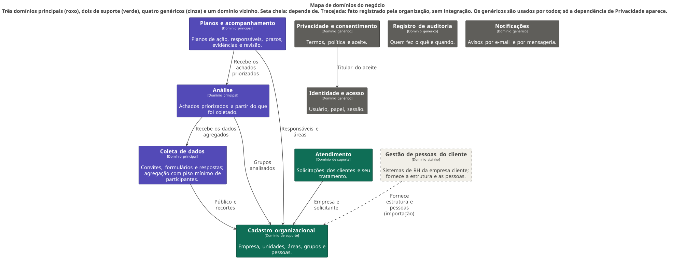
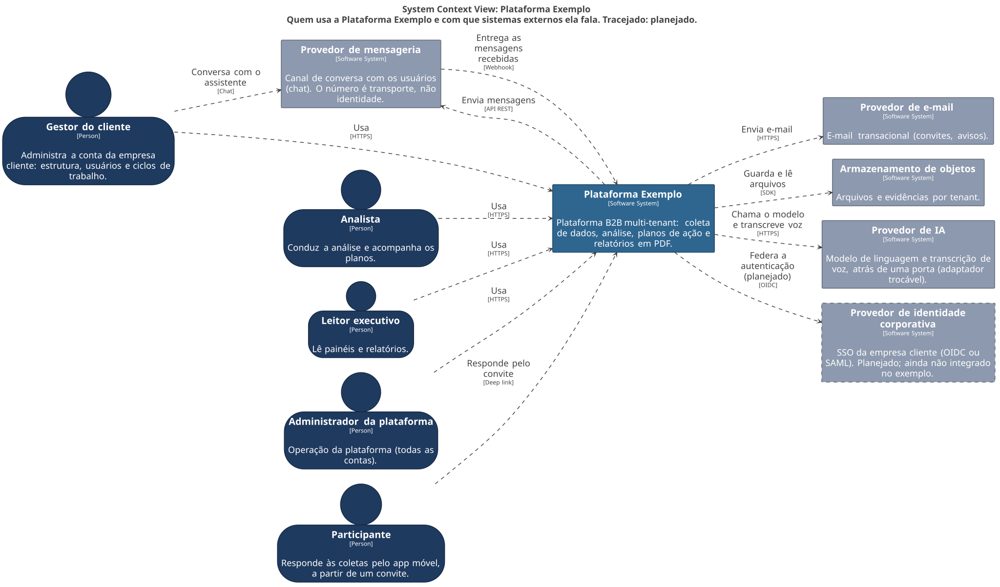
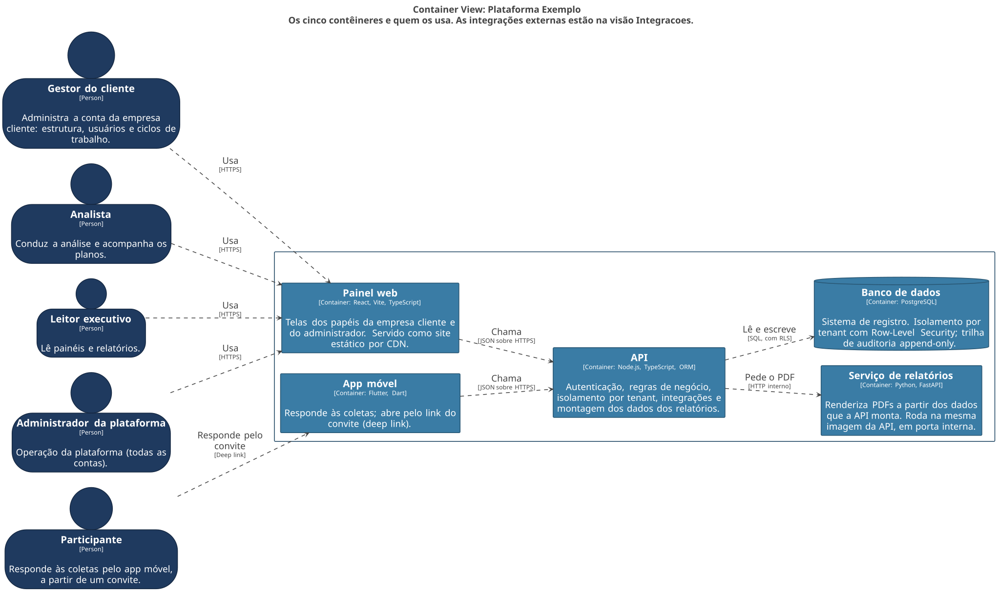
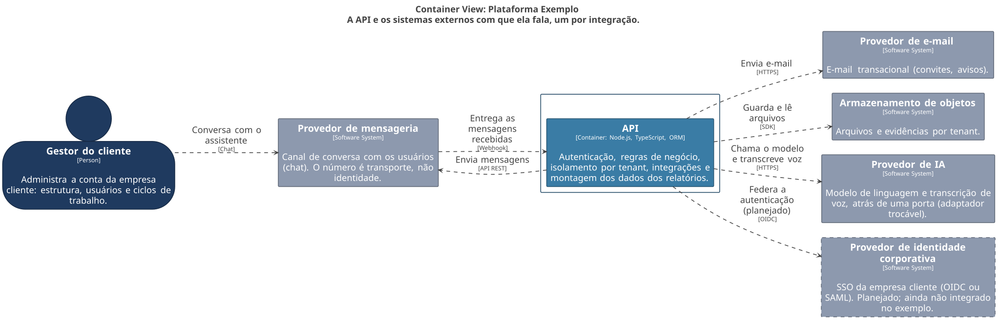
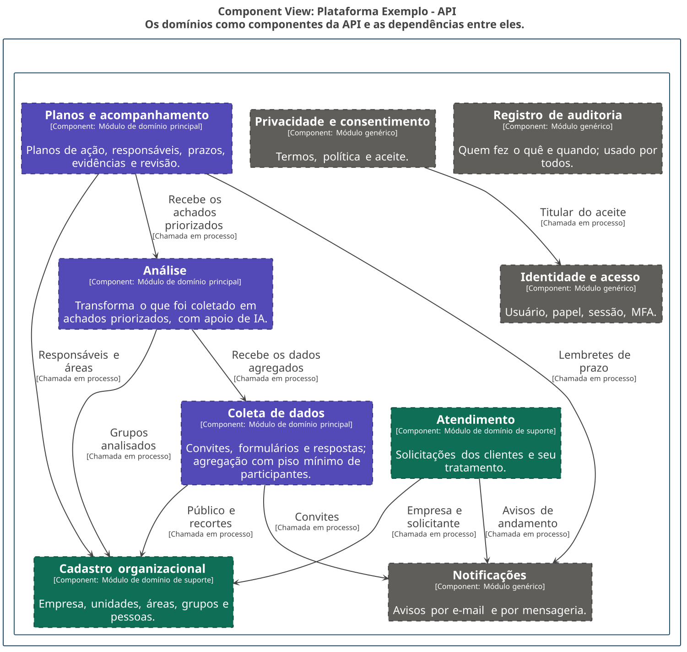
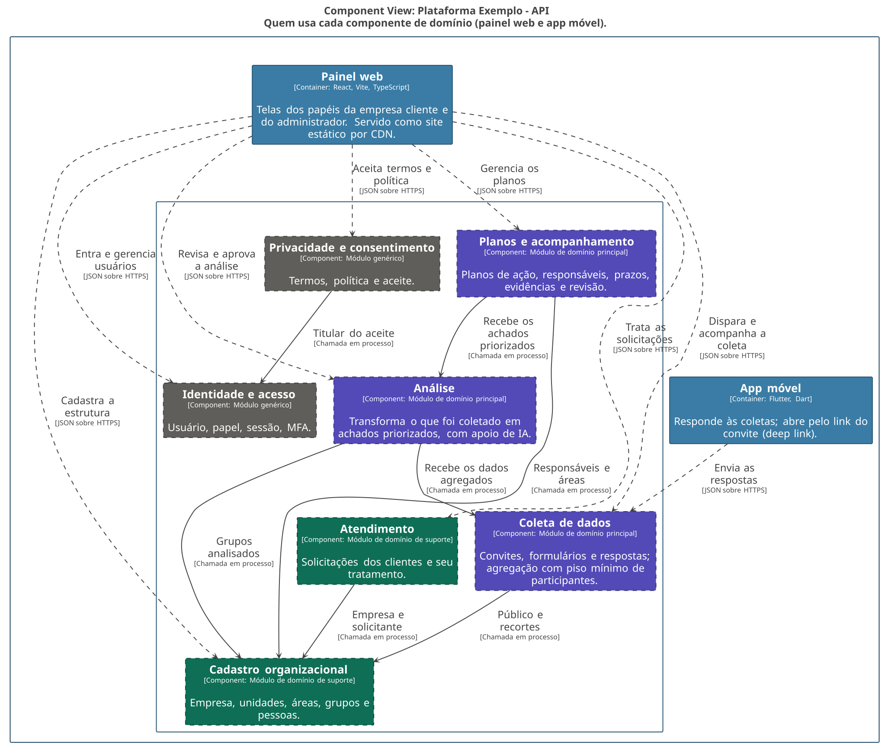
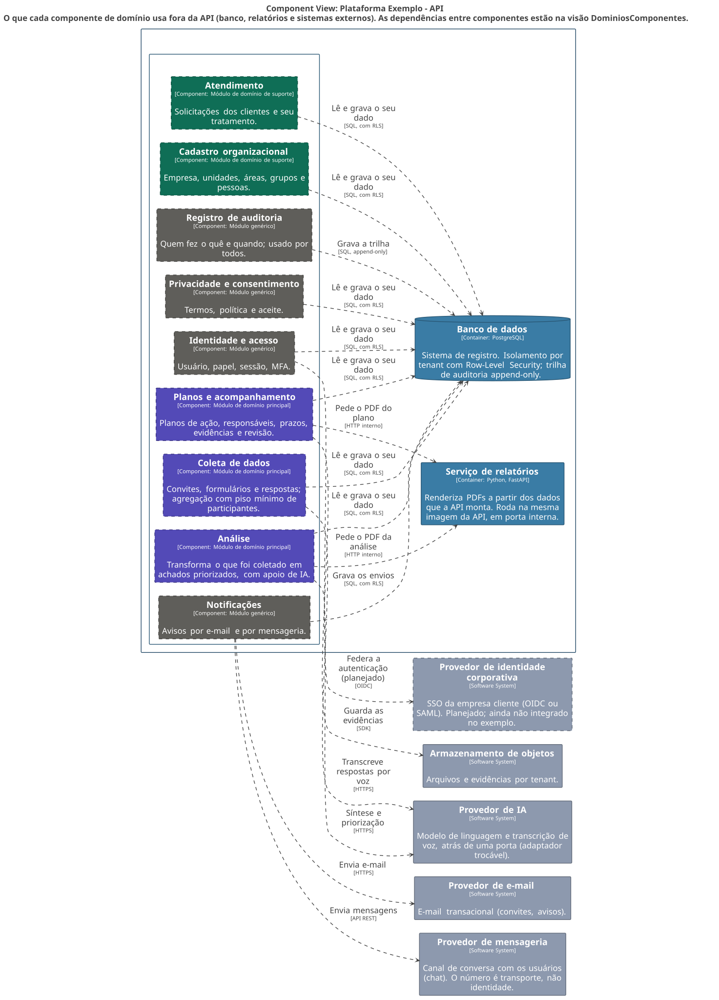
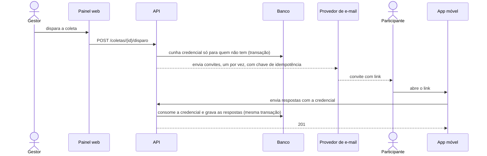
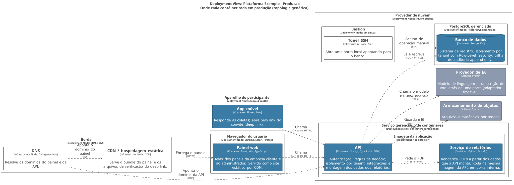
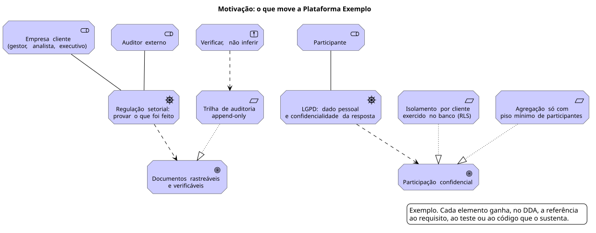

# DDA: Documento de Descrição da Arquitetura da Plataforma Exemplo

> **Exemplo ilustrativo.** A Plataforma Exemplo é fictícia: nomes, domínios, fornecedores, números e topologia são genéricos e servem para mostrar o método (C4 em Structurizr DSL, DDA no modelo de 23 seções, RDA no formato MADR ampliado, ArchiMate em PlantUML). Metas e valores aparecem como exemplo de preenchimento, não como medição.
>
> Índice da coleção: [`../README.md`](../README.md).

## Como ler este documento

| Parte | Para quem | Conteúdo |
|---|---|---|
| 0 a 2 | quem decide | controle, resumo, escopo, partes interessadas |
| 3 a 6 | quem especifica | requisitos, atributos de qualidade, restrições, estratégia |
| 7 a 12 | quem constrói e opera | contexto, contêineres, execução, dados, integrações, implantação |
| 13 a 19 | quem opera, protege e audita | segurança, resiliência, entrega, validação, custos, riscos, migração |
| 20 a 22 | quem revisa | viewpoints, rastreabilidade, glossário e anexos |

## 0. Controle documental e governança

### 0.1 Identificação e ciclo de vida

| Campo | Preenchimento |
|---|---|
| ID do DDA / sistema / domínio | DDA-EXEMPLO-001 / Plataforma Exemplo / plataforma B2B multi-tenant |
| Sistema de interesse | plataforma que conduz, para cada empresa cliente, um ciclo de coleta de dados, análise, plano de ação e relatório em PDF. Limites na §2.1 |
| Linha de base descrita | AS-IS do código no branch principal de desenvolvimento |
| Dono do produto e arquiteto responsável | papéis nomeados na organização |
| Repositórios e artefatos oficiais | monorepo com `apps/` e `services/`; modelo [`../workspace.dsl`](../workspace.dsl); contrato HTTP em OpenAPI; schema do banco no ORM; RDAs em [`../rda/`](../rda/) |
| Próxima revisão e gatilhos | toda entrega que toque contêiner, integração, dado ou fronteira de confiança |
| Classificação e controle de acesso | interno; sem segredo neste documento |

### 0.2 Revisores e aprovações

| Papel | Responsabilidade |
|---|---|
| Arquiteto responsável | consistência técnica e decisões |
| Engenharia / plataforma | viabilidade de entrega e operação |
| Segurança e privacidade | controles e riscos |
| Dono do produto | escopo, resultados e trade-offs |

**Critério de aprovação:** a versão 1.0 é aprovada quando toda seção tiver conteúdo verificado, N/A justificado ou Pendente com responsável. Assinatura não substitui teste nem análise de risco.

## 1. Resumo executivo e objetivos

### 1.1 Problema de negócio e resultado esperado

**Problema:** empresas precisam coletar dados de pessoas, transformá-los em achados, agir sobre eles e provar o que foi feito. Sem plataforma, cada etapa vive numa planilha diferente e a prova não se sustenta.
**Resultado esperado:** um ciclo em que cada etapa justifica a seguinte, com trilha que prova que nada foi alterado, coleta que preserva a confidencialidade do participante e relatórios que terceiros aceitam.
**Principais restrições:** LGPD (dado pessoal, confidencialidade da resposta), isolamento entre clientes, equipe pequena.

### 1.2 Síntese da solução

Monólito modular: uma API em Node.js e TypeScript sobre PostgreSQL, multi-tenant por Row-Level Security no banco, autenticação própria com MFA, integrações atrás de portas e adaptadores, e um serviço Python de PDF na mesma imagem de contêiner. Dois clientes: o painel web (React, servido por CDN) e o app móvel (Flutter) para o participante responder pelo convite. Externos: mensageria, e-mail, armazenamento de objetos e provedor de IA. Produção num provedor de nuvem: serviço gerenciado de contêineres e PostgreSQL gerenciado em rede privada.

### 1.3 Resumo de decisões e pontos de atenção

| Item | Síntese | Rastreabilidade |
|---|---|---|
| Decisão estrutural central | isolamento por cliente exercido no banco (RLS e papel sem bypass), não só na aplicação | DEC-02 |
| Trade-off de maior impacto | coleta por credencial de uso único: confidencialidade forte ao custo de nunca ligar resposta a pessoa, nem para suporte | DEC-04 |
| Risco principal | dependência de cota do provedor de IA nas etapas de análise | RIS-02 |

## 2. Sistema de interesse, escopo e contexto organizacional

### 2.1 Fronteira de escopo

**Incluído:** cadastro da estrutura do cliente; convites e coleta; análise com apoio de IA; planos de ação com evidências; relatórios em PDF; atendimento; assistente por mensageria.
**Excluído:** integração com sistemas de RH do cliente (importação por arquivo apenas); SSO corporativo (planejado).
**Fronteiras de responsabilidade:** a equipe opera API, banco, painel, app e infraestrutura; mensageria, e-mail, objetos e IA são serviços gerenciados sob contrato próprio.

### 2.2 Premissas, dependências e incógnitas

| ID | Tipo | Descrição | Impacto se falsa | Validação |
|---|---|---|---|---|
| PRE-01 | premissa | o runtime conecta ao banco com papel de menor privilégio, sem bypass de RLS | alto: isolamento só na aplicação | teste de isolamento contra o ambiente |
| DEP-01 | dependência | cota do provedor de IA (requisições e tokens por minuto) | médio: análise em lote fica lenta | monitorar 429 |
| DEP-02 | dependência | limite de taxa do provedor de e-mail | médio: convites atrasados | transporte serializado com retry |
| INC-01 | incógnita | volume por cliente e por ciclo | alto para §12.2 e §17 | medir no primeiro trimestre |

### 2.3 Partes interessadas e preocupações

| Parte interessada | Preocupação / pergunta decisiva | Visão que responde |
|---|---|---|
| Dono do produto e arquiteto | onde cada regra vive; o que está decidido e por quê | §6, §8, §21 |
| Agentes de implementação | fronteiras entre contêineres, contratos, o que uma mudança toca | §8, §10, §11 |
| Auditor externo | de onde vem cada documento; como a trilha prova que não foi alterado | §3.1, §10, §13 |
| Jurídico e encarregado de dados | onde vive o dado pessoal; como confidencialidade e isolamento se sustentam | §10, §13 |
| Parceiro em due diligence | topologia, fornecedores, dependências e substitutos | §7, §12, §17 |
| Participante | ninguém liga minha resposta a mim | §10.2, DEC-04 |
| Desenvolvedor novo | por onde começar | §8, §9, §15 |

### 2.4 Vocabulário e domínios

O mapa de domínios do negócio separa principais, de suporte e genéricos. A palavra "contêiner" aqui é a do C4 (unidade executável ou de dados), não a do Docker, salvo quando dito.

## 3. Requisitos arquiteturalmente significativos

### 3.1 Capacidades e requisitos funcionais críticos

| ID | Capacidade / caso de uso | Prioridade | Componentes | Evidência de aceite |
|---|---|---|---|---|
| RF-01 | coletar respostas por convite, uma credencial de uso único por pessoa, com piso mínimo de participantes em toda agregação | alta | CNT-02, CNT-03, CNT-05 | tabela de credenciais sem identificador da pessoa |
| RF-02 | produzir a análise a partir dos dados agregados, com apoio de IA e revisão humana | alta | CNT-03, EXT-04 | teste de serviço |
| RF-03 | gerir planos de ação com responsável, prazo, evidência e revisão | alta | CNT-03, CNT-05, EXT-03 | teste de serviço |
| RF-04 | emitir relatórios em PDF imutáveis depois de aprovados | alta | CNT-03, CNT-04 | teste de renderização |
| RF-05 | operar pelo assistente de mensageria com identidade pareada | média | CNT-03, EXT-01 | teste de pareamento |
| RF-06 | aceitar eletronicamente Termos e Política, com hash do texto exibido | alta | CNT-03, CNT-05 | portão no servidor |

### 3.2 Jornadas e cenários críticos

| ID | Gatilho | Passos essenciais | Resultado / falha esperada | Rastreio |
|---|---|---|---|---|
| CEN-01 | gestor dispara a coleta | API cunha uma credencial por pessoa, envia o convite por e-mail; participante abre o link no app e envia; a credencial é consumida na mesma transação das respostas | segundo envio não cunha segunda credencial | RF-01, DIN-01 |
| CEN-02 | analista fecha o ciclo | análise priorizada; plano com evidências; PDF emitido | plano não conclui sem evidência | RF-02 a RF-04 |
| CEN-03 | usuário pareia a mensageria | painel emite código; usuário envia ao bot; bot devolve confirmação; usuário digita no painel | quem tem só o código ou só a sessão não conclui | RF-05 |

## 4. Atributos de qualidade e requisitos não funcionais

### 4.1 Catálogo de metas mensuráveis

| ID | Atributo | Meta verificável (exemplo) | Método |
|---|---|---|---|
| RNF-01 | latência | p95 < 500 ms nas rotas de leitura | métrica do ingress |
| RNF-02 | disponibilidade | 99,5% mensal | sonda externa |
| RNF-03 | recuperação | RPO 24 h, RTO 4 h | exercício de restauração semestral |
| RNF-04 | segurança | zero linhas de outro cliente em qualquer consulta | teste de isolamento no bootstrap |
| RNF-05 | privacidade | nenhuma agregação abaixo do piso; credencial sem identificador | teste de serviço |
| RNF-06 | evolutividade | suíte verde é portão de merge | CI |
| RNF-07 | integridade | trilha append-only com cadeia de hash verificável | verificador da cadeia |

### 4.2 Cenários de qualidade

| Elemento | Cenário RNF-04, isolamento |
|---|---|
| Fonte e estímulo | rota nova consulta tabela de cliente sem contexto de tenant |
| Ambiente e artefato | API em qualquer ambiente; pool de conexões com contexto |
| Resposta esperada | a RLS nega: sem contexto, nenhuma linha (fail-closed) |
| Medida de resposta | zero linhas de outro cliente |
| Evidência | teste de isolamento e teste que trava a superfície de bypass declarada |

## 5. Restrições, princípios e critérios de desenho

| ID | Restrição ou princípio | Fonte / justificativa | Tipo | Implicação |
|---|---|---|---|---|
| RES-01 | isolamento por cliente no banco, com papel sem bypass | LGPD; defesa em profundidade | obrigatório | toda tabela com identificador de cliente tem policy, ou consta numa lista de exceções com motivo |
| RES-02 | ambiente local parte do mesmo schema de produção, com as mesmas garantias (RLS, triggers, CHECK) | teste que prova menos do que aparenta é pior que nenhum | obrigatório | bootstrap local com portões que abortam |
| RES-03 | fuso horário vem do processo, dia civil é `date` no banco | consistência temporal | obrigatório | uma constante por camada |
| RES-04 | arquitetura documentada como código, em texto | [RDA-0001](../rda/0001-documentacao-de-arquitetura-como-codigo.md) | obrigatório | nenhuma imagem editada à mão |
| PRI-01 | documento emitido não recebe texto fabricado: números vêm do servidor, falha da IA aparece como degradada | risco jurídico | princípio | conteúdo fixo é do código; o modelo devolve escolhas estruturadas |
| PRI-02 | nada escreve no banco no boot | operação | princípio | seeds são comandos manuais versionados |
| PRI-03 | portão no servidor, nunca só na tela | segurança | princípio | aceite legal, papéis e RLS no servidor |

## 6. Estratégia arquitetural e decisões estruturantes

**Estilo / composição:** monólito modular (API) com um serviço auxiliar de PDF na mesma imagem; dois clientes; integrações atrás de portas e adaptadores.
**Particionamento do domínio:** módulos por domínio do negócio, com um dono por tabela e dependência numa só direção.
**Comunicação:** síncrona em JSON sobre HTTPS entre clientes e API; HTTP interno entre API e relatórios; fila em PostgreSQL (`SKIP LOCKED`) para mensageria e jobs.
**Consistência e transações:** transação local para tudo o que prova algo (credencial consumida com as respostas; trilha na mesma transação do ato); imutabilidade por trigger nos documentos aprovados.

| Decisão | Alternativas | Decisão vigente | Impacto no DDA | RDA |
|---|---|---|---|---|
| DEC-01 | provedor externo de autenticação; autenticação própria | própria, com ponto de extensão para SSO | §13.1 | a registrar |
| DEC-02 | isolamento só na aplicação; RLS no banco | RLS com papel de menor privilégio | §10, §13 | a registrar |
| DEC-03 | número de telefone como identidade; identidade pareada | identidade pareada em duas etapas; número é transporte | §11, §13 | a registrar |
| DEC-04 | link coletivo; credencial de uso único | credencial de uso único por convite | §10.2 | a registrar |
| DEC-05 | fila externa; fila em PostgreSQL | PostgreSQL primeiro | §6, §14 | a registrar |
| DEC-06 | ferramenta gráfica; texto versionado | texto | §15, §20 | [RDA-0001](../rda/0001-documentacao-de-arquitetura-como-codigo.md) |

## 7. Visão de contexto (C4, nível 1)

**Objetivo:** quem usa o sistema e com que sistemas externos ele fala. **Artefato:** gerado de [`../workspace.dsl`](../workspace.dsl).

| ID | Elemento externo | Papel | Dados trocados | Protocolo | Limite de confiança |
|---|---|---|---|---|---|
| EXT-01 | Provedor de mensageria | canal do assistente | mensagens e mídia | API REST para enviar; webhook para receber | externo; webhook validado no ingresso |
| EXT-02 | Provedor de e-mail | e-mail transacional | endereço, assunto, corpo com link | HTTPS, chave de API de escopo mínimo | externo |
| EXT-03 | Armazenamento de objetos | arquivos e evidências | arquivos; o banco guarda o caminho, nunca a URL assinada | SDK | mesma conta de nuvem |
| EXT-04 | Provedor de IA | modelo de linguagem e transcrição | prompts com dado do cliente, declarado como dado e não como ordem | HTTPS | externo |
| EXT-05 | Provedor de identidade corporativa | SSO (planejado) | asserções de identidade | OIDC | externo |

## 8. Visão estrutural (C4, níveis 2 e 3)

### 8.1 Contêineres de software

| ID | Contêiner | Responsabilidade | Tecnologia | Interfaces | Código |
|---|---|---|---|---|---|
| CNT-01 | Painel web | telas por papel | React, Vite, TypeScript | consome API-01 | `apps/web` |
| CNT-02 | App móvel | coleta; abre pelo convite | Flutter, Dart | consome API-02 | `apps/mobile` |
| CNT-03 | API | autenticação, regras, RLS, integrações, dados dos relatórios | Node.js, TypeScript, ORM | expõe API-01, API-02, EVT-01 | `services/api` |
| CNT-04 | Serviço de relatórios | renderização de PDF | Python, FastAPI | expõe API-03 (interno) | `services/reports` |
| CNT-05 | Banco de dados | sistema de registro; RLS; trilha | PostgreSQL | SQL | `services/api/db` |

### 8.2 Componentes internos relevantes

| ID | Componente | Responsabilidade | Dependências permitidas |
|---|---|---|---|
| CMP-01 | Coleta de dados | convites, respostas, agregação com piso | Cadastro, Notificações |
| CMP-02 | Análise | achados priorizados | Coleta, Cadastro |
| CMP-03 | Planos e acompanhamento | planos, evidências, revisão | Análise, Cadastro, Notificações |
| CMP-04 | Cadastro organizacional | estrutura do cliente | nenhuma de domínio |
| CMP-05 | Atendimento | solicitações | Cadastro, Notificações |
| CMP-06 | Identidade, Privacidade, Auditoria, Notificações | genéricos, usados por todos | Privacidade depende de Identidade |

**Dependência proibida:** rota com regra de negócio; módulo genérico que dependa de módulo de domínio; ciclo entre módulos.

## 9. Visões de execução, estados e concorrência

### 9.1 Catálogo de cenários dinâmicos

| ID | Cenário | Tipo de fluxo | Situação excepcional |
|---|---|---|---|
| DIN-01 | convite, credencial e resposta | síncrono com e-mail assíncrono serializado | 429 do e-mail desacelera o envio; credencial já usada é recusada |
| DIN-02 | análise em lote com IA | job em background com polling | 429 do provedor marca o item como degradado; segundo disparo recebe 409 |
| DIN-03 | pareamento da mensageria | assíncrono (webhook, fila, worker) | código expirado ou usado por outro aparelho |

### 9.2 Especificação de uma interação crítica: DIN-01

**Limites transacionais:** cunhagem e registro do convite numa transação; consumo e respostas noutra; e-mail fora de transação, com idempotência.
**Concorrência e idempotência:** disparo incremental; consumo atômico (`UPDATE ... WHERE usada_em IS NULL RETURNING`).

## 10. Arquitetura de dados e governança da informação

### 10.1 Modelo e propriedade dos dados

| ID | Entidade / conjunto | Classificação | Proprietário | Retenção (exemplo) |
|---|---|---|---|---|
| DATA-01 | estrutura do cliente e pessoas | dado pessoal | cliente | enquanto durar o contrato |
| DATA-02 | respostas e credenciais | confidencial, sem vínculo com a pessoa | cliente | 5 anos |
| DATA-03 | análises, planos, evidências, relatórios | documento; imutável depois de aprovado | cliente | não se expurga (prova) |
| DATA-04 | trilha de auditoria e aceites | probatório; append-only | plataforma | sem expurgo |
| DATA-05 | identidades, sessões, MFA | credencial; segredo cifrado | plataforma | enquanto ativo |

**Evolução de esquema:** migrations numeradas e aditivas; destrutivas documentadas no cabeçalho; registro de migrations no banco decide o que se aplica.
**Transações e consistência:** ACID local; eventual só no e-mail e na fila da mensageria.

### 10.2 Proteção e ciclo de vida

**Minimização e controle de acesso:** credencial sem identificador; papéis por rota e por tela; RLS por cliente; superfície de bypass declarada e travada por teste.
**Criptografia:** TLS em todo trânsito; SSL obrigatório ao banco; segredo de MFA cifrado; senha com função de derivação de chave.
**Retenção e eliminação:** por conjunto (tabela acima), com expurgo auditado.
**Transferência e terceiros:** os provedores da §7, com contrato de suboperador.

## 11. APIs, integrações e eventos

| ID | Produtor e consumidor | Interface / evento | Autenticação | Falhas e evolução |
|---|---|---|---|---|
| API-01 | CNT-01 para CNT-03 | JSON sobre HTTPS, OpenAPI 3.1 | cookie de sessão httpOnly; MFA; portão legal | 409 com motivo em recusa fundamentada; 410 em rota aposentada |
| API-02 | CNT-02 para CNT-03 | coleta por credencial | a credencial é a autorização inteira | credencial usada ou inexistente recusada sem oráculo |
| API-03 | CNT-03 para CNT-04 | HTTP interno | rede interna da imagem | sem URL configurada, falha explícita |
| EVT-01 | EXT-01 para CNT-03 | webhook de mensagens | assinatura validada; dedupe por id da mensagem | inbox e fila em PostgreSQL |
| EVT-02 | CNT-03 para EXT-02 | envio de e-mail | chave de API | retry respeitando `retry-after`; chave de idempotência |

## 12. Visão física, implantação e infraestrutura

### 12.1 Topologia e ambientes

**Ambientes:** local (PostgreSQL em Docker, mesmo bootstrap de schema) e produção.
**Fronteiras de rede:** banco em rede privada sem endpoint público; serviço de contêineres integrado à rede; bastion para operação manual; DNS e CDN na borda.
**Plataforma de execução:** uma imagem Docker com API e serviço de relatórios; CDN para o bundle do painel; app nas lojas.

### 12.2 Inventário de recursos

| ID | Recurso | Alta disponibilidade | Infra como código |
|---|---|---|---|
| INF-01 | serviço gerenciado de contêineres (API e relatórios) | duas réplicas (exemplo) | sim |
| INF-02 | PostgreSQL gerenciado | backup automático do provedor | sim |
| INF-03 | armazenamento de objetos | padrão do provedor | sim |
| INF-04 | provedor de IA | n/a | sim |
| INF-05 | bastion | sob demanda | sim |
| INF-06 | CDN e DNS | padrão do provedor | sim |

## 13. Segurança, privacidade e conformidade

### 13.1 Modelo de ameaças e fronteiras de confiança

**Ameaças relevantes:** acesso entre clientes; reidentificação de participante; sequestro de identidade na mensageria; injeção de prompt por dado do cliente; alteração de documento emitido; vazamento de URL assinada.
**Identidade e sessão:** autenticação própria com bloqueio por tentativas; sessão no banco e cookie httpOnly; MFA por TOTP; tokens de uso único guardados só como hash.
**Autorização:** papéis nos guards de rota e na tela; RLS por cliente no banco; portão legal no servidor.

### 13.2 Matriz de controles

| ID | Requisito / risco | Controle arquitetural | Evidência |
|---|---|---|---|
| SEC-01 | acesso entre clientes | RLS com FORCE; papel sem bypass; contexto fail-closed | teste de isolamento |
| SEC-02 | sequestro na mensageria | pareamento em duas etapas; revogação | teste de pareamento |
| SEC-03 | injeção de prompt | dado declarado como dado; ação sensível exige confirmação | teste de guarda |
| SEC-04 | alteração de documento | trigger de imutabilidade; trilha com hash | verificador da cadeia |
| PRIV-01 | reidentificação | credencial sem identificador; piso mínimo de agregação | teste de serviço |

## 14. Resiliência, observabilidade e operação

**Dependências críticas:** banco (tudo), provedor de IA (análise), e-mail (convites), mensageria (assistente).
**Resiliência:** retry com backoff e jitter respeitando `retry-after`; timeout por chamada; semáforo de concorrência na IA; fila com `SKIP LOCKED`.

| Sinal | Fonte | Objetivo |
|---|---|---|
| métrica | ingress e runtime | latência, erros, saturação |
| rastro | OpenTelemetry | fluxo entre contêineres |
| log | stdout agregado | investigação |
| trilha | tabela de auditoria | prova |

## 15. Engenharia de entrega e evolução

**Repositório:** monorepo com uma pasta por contêiner e uma para especificações e arquitetura.
**Pipelines:** CI com build, testes e validação da documentação (modelo e links).
**Implantação:** imagem única publicada no serviço de contêineres; painel publicado na CDN; migrations antes do deploy quando aditivas.
**Rollback:** redeploy da imagem anterior; migrations destrutivas não têm volta e se documentam como tal.
**Ambientes de teste:** banco local do zero pelo bootstrap, com portões que abortam (schema, migrations, isolamento).

## 16. Validação arquitetural e evidências

| ID | Hipótese / requisito | Tipo de validação | Evidência esperada |
|---|---|---|---|
| VAL-01 | SEC-01 isolamento | teste de isolamento em banco montado do zero | todas as asserções verdes |
| VAL-02 | SEC-04 trilha íntegra | verificador da cadeia de hash | cadeia íntegra |
| VAL-03 | RNF-06 suíte verde | testes de todos os contêineres | tudo verde |
| VAL-04 | RNF-01 a RNF-03 | carga e exercício de recuperação | relatórios |
| VAL-05 | modelo coerente | `structurizr.sh validate` e `inspect`; verificador de links | sem erro |

## 17. Custos, capacidade e viabilidade operacional

| Item | Modelo de custo | Sensibilidade |
|---|---|---|
| computação | por réplica e recurso | número de réplicas |
| dados | por armazenamento e backup | retenção das evidências |
| IA | por token | cota limita antes do custo |
| e-mail e mensageria | por envio | tamanho da base de participantes |

## 18. Riscos arquiteturais e dívida técnica

| ID | Risco / dívida | Probabilidade / impacto | Mitigação |
|---|---|---|---|
| RIS-01 | papel do runtime com bypass por engano | baixa / alto | teste de isolamento no boot e no bootstrap |
| RIS-02 | cota do provedor de IA | média / médio | adaptador trocável; marcação de degradado |
| RIS-03 | cookie de sessão entre domínios bloqueado pelo navegador | média / médio | API na mesma origem do painel, por proxy de borda |
| RIS-04 | modelo de arquitetura envelhece em relação ao código | média / médio | propriedade `codigo`, verificador de links, revisão a cada entrega (RDA-0001) |

## 19. Estratégia de implantação, migração e desativação

**Compatibilidade:** migrations aditivas antes do deploy; destrutivas junto com o deploy que remove o último leitor da forma antiga.
**Rollback:** imagem anterior; migrations não destrutivas toleram.
**Descomissionamento:** N/A neste exemplo.

## 20. Catálogo de viewpoints, views e correspondências

| Viewpoint | Interessados e preocupações | Modelo / notação |
|---|---|---|
| VP-CTX | dono, parceiro, jurídico / fronteiras e terceiros | C4 contexto, `Contexto` |
| VP-DOM | dono, arquiteto / áreas do negócio | mapa de domínios, `Dominios` |
| VP-STR | arquiteto, agentes / responsabilidade | C4 níveis 2 e 3, `Conteineres`, `Integracoes`, `Dominios*` |
| VP-RUN | operação, auditor / ordem e falhas | Mermaid (§9) |
| VP-DAT | jurídico, auditor / propriedade e ciclo de vida | tabela DATA (§10) |
| VP-DEP | operação, parceiro / implantação | C4 implantação, `Producao` |
| VP-SEC | jurídico, auditor / ameaças e controles | matriz SEC e PRIV (§13) |
| VP-MOT | auditor, parceiro / por que o sistema existe | ArchiMate motivação, [`motivacao.puml`](../archimate/motivacao.puml) |

### 20.1 Correspondências e consistência cruzada

| Elemento ArchiMate | Elemento C4 | Código |
|---|---|---|
| Application Component "Painel web" | CNT-01, `exemplo.web` | `apps/web` |
| Application Component "App móvel" | CNT-02, `exemplo.app` | `apps/mobile` |
| Application Component "API" | CNT-03, `exemplo.api` | `services/api` |
| Application Component "Serviço de relatórios" | CNT-04, `exemplo.relatorios` | `services/reports` |
| System Software "PostgreSQL" e Data Objects | CNT-05, `exemplo.db` | `services/api/db` |

## 21. Rastreabilidade, evolução e decisões

| Origem | Decisão | Elemento de solução | Teste / evidência |
|---|---|---|---|
| RF-01, PRIV-01 | DEC-04 | credencial de uso único | VAL-01 |
| SEC-01 | DEC-02 | RLS e papéis | VAL-01 |
| RF-05, SEC-02 | DEC-03 | pareamento | teste de pareamento |
| RES-04 | DEC-06, RDA-0001 | pasta de arquitetura | VAL-05 |

**Política de manutenção:** toda entrega que toque contêiner, integração, dado ou fronteira atualiza o `workspace.dsl` e este DDA na mesma mudança; decisão nova vira RDA pelo template antes do merge.

## 22. Glossário, anexos e referências

### 22.1 Glossário

| Termo | Definição neste sistema |
|---|---|
| Cliente (tenant) | empresa contratante; unidade de isolamento dos dados |
| Credencial de uso único | código por convite; a autorização inteira do participante; só o hash no banco |
| Piso de agregação | número mínimo de participantes para exibir qualquer resultado agregado |
| RLS | Row-Level Security do PostgreSQL, com policy, FORCE e papel sem bypass |
| Contêiner (C4) | unidade executável ou repositório de dados; não é contêiner Docker |
| DDA | Documento de Descrição da Arquitetura |
| RDA | Registro de Decisão de Arquitetura (ADR) |

### 22.2 Referências de metodologia

- ISO/IEC/IEEE 42010:2022, Architecture description: https://www.iso.org/standard/74393.html
- ISO/IEC 25010:2023, Product quality model: https://www.iso.org/standard/78176.html
- arc42: https://arc42.org/overview/
- C4 model: https://c4model.com/diagrams
- Michael Nygard, "Documenting Architecture Decisions" (2011): https://cognitect.com/blog/2011/11/15/documenting-architecture-decisions
- MADR 4.0.0: https://adr.github.io/madr/
- Structurizr: https://docs.structurizr.com
